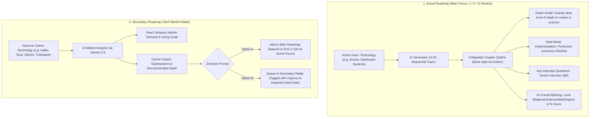

# Dhaap (ধাপ) — Lifelong Engineering Learning Engine

[-black?style=flat&logo=next.js)](https://nextjs.org/)
[](https://react.dev/)
[](https://www.typescriptlang.org/)
[](https://tailwindcss.com/)
[-47A248?style=flat&logo=mongodb)](https://www.mongodb.com/)
[-6366F1?style=flat)](https://www.better-auth.com/)
[](https://ai.google.dev/)
[-729B1B?style=flat&logo=vitest)](https://vitest.dev/)
[](https://biomejs.dev/)

> **ধাপ (Dhaap)** — A Bengali word meaning "Step" or "Stair". 
> **Dhaap** is an autonomous, spaced-repetition engineering curriculum engine built for software engineers striving to transition from Mid-Level to Senior and Staff engineering roles.

---

## 🌟 Key Product Philosophy & Architecture

Most learning platforms present passive video playlists that lead to high drop-out rates and rapid memory decay. **Dhaap** is engineered with a **deterministic core**, **SM-2 spaced repetition**, and **AI-powered rubric evaluations**:

```
                                  DHAAP ARCHITECTURE
┌────────────────────────────────────────────────────────────────────────────────────────┐
│                               Presentation Layer (Next.js 16)                          │
│   /today            /roadmap               /review               /notes     /settings  │
│  (Daily Plan)   (Dual Curriculums)   (Retention & Flashcard)    (Notebook)   (Caps)    │
└───────────────────────────────────────────┬────────────────────────────────────────────┘
                                            │
┌───────────────────────────────────────────▼────────────────────────────────────────────┐
│                             Application & API Services                                 │
│  • Spaced Repetition State Machine               • Multi-Model Gemini AI Fallback      │
│  • Intelligent TTL AI Cache Layer                • Voice Transcription (Gemini Flash)  │
│  • Better Auth with MongoDB Adapter              • Nightly Plan Generator Cron         │
└───────────────────────────────────────────┬────────────────────────────────────────────┘
                                            │
┌───────────────────────────────────────────▼────────────────────────────────────────────┐
│                    Deterministic Core Engine (src/core/) — ZERO DB/AI                  │
│   • Scoring Engine (Rubric match, mustMention 60-cap limit)                            │
│   • Spaced Repetition (Intervals: 1, 3, 7, 14, 30, 60 days, Lapses state transitions)   │
│   • Scheduler (Daily cap, recap limits, rest days, carry-over queue)                   │
└────────────────────────────────────────────────────────────────────────────────────────┘
```

1. **Deterministic Core Logic (`src/core/`)**: All business logic (scoring algorithms, spaced intervals, daily study schedule distribution) consists of pure, deterministic functions independent of any database or external AI API. Unit tests execute in **< 15ms**.
2. **Hybrid AI Evaluation**: AI is never asked to arbitrarily assign numbers. Gemini evaluates candidate answers strictly against technical rubric concepts, quotes verbatim proof (`evidence`), and our deterministic scoring math calculates the final score with a mandatory **60% cap** if critical `mustMention` concepts are missing.
3. **Multi-Model Resilient AI Pipeline**: Primary AI requests use `gemini-3.5-flash` with automatic fallback to `gemini-3.6-flash`, `gemini-3.1-flash-lite`, and `gemini-3.8-flash` with brief backoff pauses to resist spikes and rate limits.
4. **Intelligent AI Cache**: MongoDB TTL-backed cache (`AICache`) automatically saves completed technology analyses and quiz sets for 7 days, reducing external API costs by up to 90% and delivering instant **10-20ms** responses for common queries.

---

## 🗺️ Dual Roadmap Workflow (Blueprint)

Dhaap implements a dual-curriculum system designed for structured learning and online tech exploration:



### 1. Actual Roadmap (Main Focus)
- **Book / Chapter Accordion**: Topics are grouped into collapsible chapters (e.g., *Chapter 1: Linux Primitives & Container Internals*, *Chapter 2: Multi-stage Builds & Networking*) with real-time completion tracking.
- **Deep Dive Spec**:
  - **Depth Guide**: High-level vs. deep production mastery guidelines.
  - **Real-World Checklist**: Concrete production tasks required to consider the topic mastered.
  - **Key Interview Questions**: Technical questions commonly asked by senior hiring managers.
  - **AI Level Assessment**: Real-time mastery calculation based on validated interview quiz attempts.

### 2. Secondary Roadmap (Tech Market Radar)
- **Instant Market Evaluation**: Analyzes any library, database, or tool online. Evaluates why companies use it, who hires for it, and how it impacts your career trajectory.
- **Decision Engine**:
  - **Option A**: Promote immediately into your Main Roadmap (set as active focus or append to existing topics).
  - **Option B**: Queue in your Secondary Radar with urgency rating (`HIGH`, `MEDIUM`, `LOW`) and target start date (e.g., *Q3 2026* or *Dec 2026*).

---

## ⚡ Core Features & Views

### 📅 `/today` — Focus Dashboard
- **Daily Study Plan**: Dynamically schedules tasks up to your configured daily cap (e.g., 240 minutes) prioritizing overdue spaced recaps before new learning items.
- **Carry-over Extraction**: Incomplete items from yesterday automatically carry over to keep you accountable.
- **Voice-Enabled Interview Quiz**: Audio response recording with client-side audio slicing, 3-minute safety timers, and Gemini audio transcription supporting English and Bengali.
- **Rubric Grading & Overrides**: Detailed breakdown of concept coverage, strengths, misconceptions, and manual instructor score overrides.

### 🧠 `/review` — Engineering Retention Center
- **60-Day Consistency Heatmap**: GitHub-style contribution matrix showing daily quiz attempts, study velocity, and live streak counters.
- **Memory Pipeline Meter**: 6-stage visual pipeline showing how many engineering topics have progressed through the SM-2 consolidation stages:
  - *Day 1 (Intro)* &rarr; *Step 2 (3d)* &rarr; *Step 3 (7d)* &rarr; *Step 4 (14d)* &rarr; *Step 5 (30d)* &rarr; *Step 6 (Mastered 60d+)*.
- **Interactive 3D Flashcard Drill (`FlashcardModal`)**:
  - Flip card mode with keyboard shortcuts (`Spacebar` to flip).
  - Quick SM-2 self-rating buttons: **Again** (< 1d), **Hard** (1-3d), **Good** (Next interval), and **Easy** (+2 Steps).
- **Recap Backlog Drill**: One-click drill targeting topics with recorded recall lapses.

### 📝 `/notes` — Technical Notebook
- Markdown study notebook linked to individual roadmap topics.
- Instant search and filtering by topic.

### ⚙️ `/settings` — Personalization & Boundaries
- Configurable daily learning time cap (minutes).
- Daily recap ceiling cap (prevents review backlog from overwhelming new learning).
- Pass score threshold (default: 70%).
- Rest day exclusion (e.g., Friday/Saturday off).
- User profile & Better Auth credential management.

---

## 📁 Repository Structure

```
dhapp-project/
├── public/                       # PWA manifest, theme icons & assets
│   ├── logo.svg
│   └── logo.png
├── src/
│   ├── app/                      # Next.js 16 App Router
│   │   ├── (app)/                # Authenticated application shell
│   │   │   ├── today/            # Daily focus & plan execution
│   │   │   ├── roadmap/          # Dual roadmaps (Main & Secondary)
│   │   │   ├── review/           # Retention heatmap & flashcard drill
│   │   │   ├── notes/            # Markdown engineering notebook
│   │   │   └── settings/         # Caps, thresholds & rest days
│   │   ├── (auth)/               # Better Auth login & register
│   │   ├── api/                  # REST & AI endpoints
│   │   │   ├── attempts/         # Quiz submissions & manual score overrides
│   │   │   ├── auth/             # Better Auth route handler
│   │   │   ├── cron/             # Nightly plan generator
│   │   │   ├── roadmaps/         # Creation, analysis, promotion, deletion
│   │   │   ├── topics/           # Topic CRUD, quizzes, flashcard reviews
│   │   │   └── voice/            # Audio transcription endpoint
│   │   └── layout.tsx            # Theme provider, font, root layout
│   ├── components/               # Modular UI components (< 300 lines each)
│   │   ├── common/               # AppHeader, BottomNav, StatusBadge
│   │   ├── quiz/                 # QuizModal, FeedbackCard, VoiceRecorder
│   │   ├── review/               # RetentionMatrix, FlashcardModal
│   │   ├── roadmap/              # TopicCard, ChapterOutline, TechAnalyzer
│   │   └── today/                # PlanItemCard, StatRing, CarryOverBanner
│   ├── core/                     # Pure Deterministic Engine (Zero DB/AI)
│   │   ├── scoring.ts            # Rubric scoring & mustMention rules
│   │   ├── spaced-repetition.ts  # Intervals [1, 3, 7, 14, 30, 60] days
│   │   ├── scheduler.ts          # Daily cap & carry-over allocation
│   │   ├── types.ts              # Domain interfaces & types
│   │   └── __tests__/            # Vitest unit test suite
│   └── lib/                      # Infrastructure & Database
│       ├── ai.ts                 # Gemini 3.5 client with fallback chain
│       ├── auth.ts               # Better Auth with @better-auth/mongo-adapter
│       ├── db.ts                 # Mongoose cached connection (DhaapDB)
│       └── models.ts             # Schemas (Roadmap, Topic, Question, Attempt, AICache)
├── biome.json                    # Biome linting and formatting configuration
├── next.config.ts                # Next.js configuration with Turbopack loaders
└── package.json
```

---

## 🚀 Getting Started

### Prerequisites
- **Node.js**: `v20.x` or higher (Node v22 / v26 tested)
- **Package Manager**: `pnpm` (recommended)
- **MongoDB**: MongoDB Atlas or local MongoDB instance
- **Google Gemini API Key**: From [Google AI Studio](https://aistudio.google.com/)

### 1. Clone & Install Dependencies

```bash
git clone https://github.com/your-username/dhaap-learning-project.git
cd dhaap-learning-project/dhapp-project
pnpm install
```

### 2. Configure Environment Variables

Create `.env.local` inside `dhapp-project/`:

```env
# MongoDB Connection (Collections are segregated under dbName: DhaapDB)
MONGODB_URI=mongodb+srv://<username>:<password>@cluster.mongodb.net/DhaapDB?retryWrites=true&w=majority

# Better Auth Secret & Base URL
BETTER_AUTH_SECRET=your-random-32-character-secret
BETTER_AUTH_URL=http://localhost:3000

# Google Gemini AI API Key
GEMINI_API_KEY=your_gemini_api_key_here
GEMINI_MODEL=gemini-3.5-flash

# Optional: Google OAuth
# GOOGLE_CLIENT_ID=your_google_client_id
# GOOGLE_CLIENT_SECRET=your_google_client_secret

# Optional: Nightly Cron Secret
CRON_SECRET=your_cron_secret_key
```

### 3. Run Development Server

```bash
pnpm dev
```

Open [http://localhost:3000](http://localhost:3000) in your browser.

---

## 🧪 Testing & Code Quality

Dhaap enforces strict coding standards and test coverage:

```bash
# Run Vitest unit tests (deterministic core engine)
pnpm test

# Check code formatting with Biome
pnpm format

# Run linter and type-checker
pnpm lint

# Run optimized production build with Turbopack
pnpm build
```

---

## 🎨 Theme & Design System

Dhaap uses an earthy, high-focus editorial aesthetic inspired by traditional stationery and modern developer workspaces:

| Token | Hex | Usage |
| :--- | :--- | :--- |
| **Sand Canvas** | `#f5ebdd` / `hsl(36, 44%, 93%)` | Background & card surfaces in light mode |
| **Terracotta** | `#c2410c` / `hsl(18, 88%, 42%)` | Primary interactive buttons, brand accents, focus rings |
| **Deep Charcoal** | `#1f2937` / `hsl(217, 33%, 17%)` | Primary typography, headers, high-contrast borders |
| **Sage & Teal** | `#0f766e` / `hsl(175, 77%, 26%)` | Spaced review due badges, interval success indicators |
| **Amber Warning**| `#b45309` / `hsl(38, 92%, 50%)` | Carry-over tasks, recall lapse alerts |

Fully supports **System**, **Dark**, and **Light** modes via `next-themes`.

---

## 📄 License

This project is licensed under the [MIT License](LICENSE).
